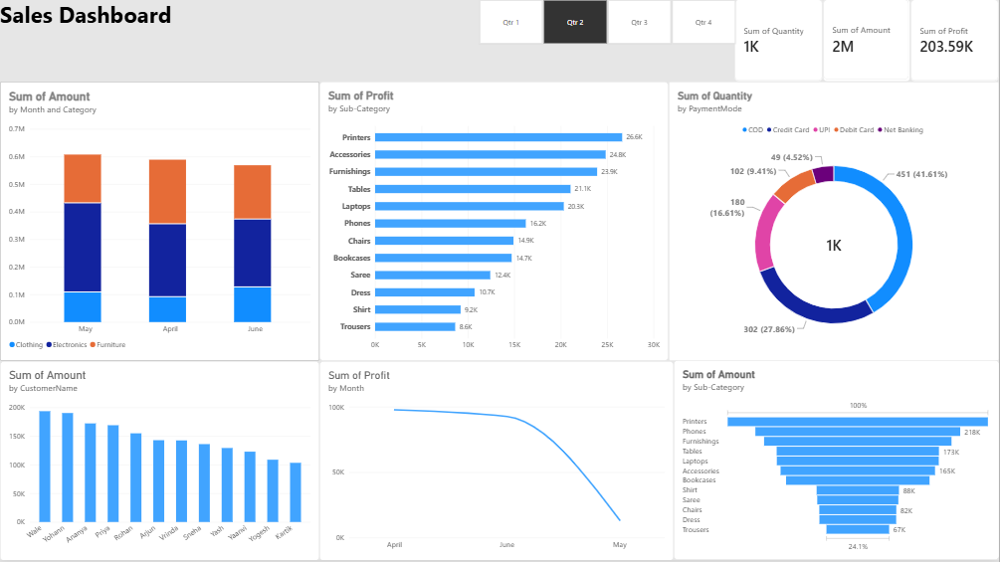

# Global E-Commerce Sales Executive Suite (Power BI)

An enterprise-grade executive dashboard designed to provide multi-dimensional visibility into e-commerce operations, order volume, profit margins, and customer retention. Built in Power BI Desktop following minimalist UI/UX design standards.



---

## Key Highlights

- **Executive KPI Ribbon**: Tracks high-level business health (Total Quantity, Net Profit, and Gross Revenue) with instant visual indicators.
- **Dynamic Quarter Slicing**: Enables cross-filtering across Qtr 1 to Qtr 4 with zero-latency visual synchronization.
- **Product & Category Analysis**: Features a 100% Stacked Column Chart detailing month-over-month category share and a horizontal Clustered Bar Chart ranking sub-categories by profitability.
- **Payment Method Distribution**: Donut visualization breaking down transaction share across COD, UPI, Cards, and Net Banking.
- **Customer Pareto Analysis**: Identifies revenue concentration across primary customer accounts.
- **Sales Funnel & Trend Trajectory**: Maps conversion progression alongside a monthly margin trajectory line chart with marker-level accuracy.

---

## Design System & Theme

| Element | Specification |
| :--- | :--- |
| **Canvas Background** | Neutral Light Slate (`#F4F5F7`) |
| **Visual Containers** | Pure White (`#FFFFFF`) with 4px rounded borders (`#E0E2E6`) |
| **Primary Palette** | Corporate Teal (`#00B5AD`), Coral Red (`#FF5A5F`), Charcoal (`#2C3E50`) |
| **Typography** | Segoe UI (Standard enterprise typeface) |

---

## Data Architecture

The underlying dataset contains 1,500 structured transaction records generated via Python (`generate_dataset.py`):

- `OrderID`: Unique alphanumeric transaction identifier
- `CustomerName`: Customer entity name
- `Category`: High-level segment (Clothing, Electronics, Furniture)
- `Sub-Category`: Granular product grouping
- `Amount`: Gross transaction value
- `Profit`: Net profit margin per order
- `Quantity`: Unit volume purchased
- `PaymentMode`: Fulfillment tender (COD, Credit Card, UPI, Debit Card, Net Banking)
- `Month` & `Quarter`: Temporal reporting dimensions

---

## How to Run Locally

1. Clone this repository:
   ```bash
   git clone [https://github.com/](https://github.com/)rakshitakulkarni/ecommerce-powerbi-sales-dashboard.git
   cd ecommerce-powerbi-sales-dashboard
